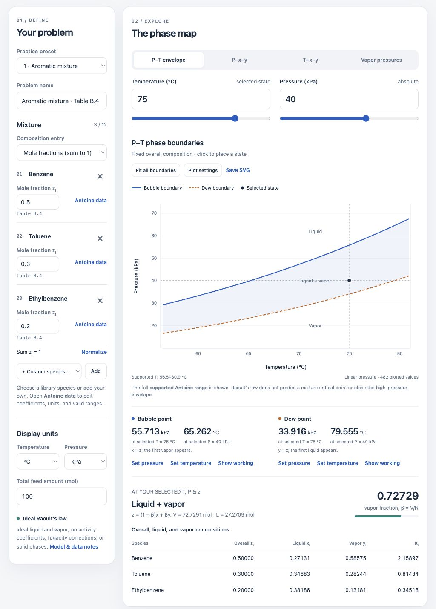

# VLE Toolkit

An interactive teaching tool for **Raoult’s law, bubble and dew points, and vapor–liquid equilibrium diagrams**. Build a mixture, change the conditions, and follow the calculations behind each graph.

The complete application is a **single HTML file**. It runs locally in a browser, including all property data and graphing code. Students do not need Python, Node.js, an account, or an internet connection.



## Open the toolkit

1. [Download the repository ZIP](https://github.com/logzmort/vle-toolkit/archive/refs/heads/main.zip) and unzip it.
2. Open **`index.html`** in a modern browser with JavaScript enabled.
3. Choose a **Practice preset**, adjust temperature or pressure, and explore the diagram tabs.
4. Scroll to **Follow the mathematics** to see the equations, substitutions, and numerical steps.

To distribute only the application, copy or email `index.html`; it does not need any other files. You can rename it to `VLE_Toolkit.html` without changing its behavior. GitHub displays the file’s source on its file page, so download it before opening it in your browser.

**[Download the practice workbook — questions and full solutions](https://github.com/logzmort/vle-toolkit/raw/refs/heads/main/docs/VLE_Practice_Questions_and_Solutions.docx).** The editable Word document contains five guided problems. Questions and reference material are on pages 1–6; worked solutions are on pages 7–16.

## What students can explore

| View or tool | What it shows |
| --- | --- |
| **P–T envelope** | Bubble and dew boundaries for the selected overall composition over the supported property-data range. |
| **P–x–y** | Binary equilibrium at fixed temperature, with liquid and vapor compositions and a selected operating pressure. |
| **T–x–y** | Binary equilibrium at fixed pressure, with liquid and vapor compositions and a selected operating temperature. |
| **Vapor pressures** | Each pure species’ saturation pressure over its own supported temperature range. |
| **Worked solution** | Unit conversions, per-species calculations, bubble/dew equations, temperature iterations, and flash balances. |
| **How this graph is built** | An explanation of the sampling procedure and the actual numerical rows used to draw the graph. |

The toolkit supports up to **12 components**, editable Antoine coefficients, multiple fits per species, and either mole fractions or relative molar amounts. Binary diagrams use their selected pair and an independent binary composition.

## Five starting problems

These presets match the workbook and keep the requested calculations within the supplied data ranges.

| Preset | Species and overall mole fractions | Starting state |
| --- | --- | --- |
| 1 · Aromatic mixture | Benzene / toluene / ethylbenzene: 0.50 / 0.30 / 0.20 | 75 °C, 40 kPa |
| 2 · Benzene + toluene | Benzene / toluene: 0.50 / 0.50 | 60 °C, 30 kPa |
| 3 · Three alkanes | n-Hexane / n-heptane / n-octane: 0.40 / 0.35 / 0.25 | 60 °C, 34 kPa |
| 4 · Methanol + ethanol | Methanol / ethanol: 0.50 / 0.50 | 62.5 °C, 70 kPa |
| 5 · Pure water | Water from Table B.3 | 25 °C, 101.325 kPa |

The alcohol preset is an **ideal-model exercise**, not a claim that the real mixture follows Raoult’s law exactly.

## Adapt it to another problem

- **Change the species.** Add a library species or a custom species. Open **Antoine data** to edit its name, coefficients, log convention, coefficient units, validity limits, and source notes.
- **Match the units.** The coefficient units must match the published equation. The toolkit accepts base-10 or natural logarithms, °C/K/°F, and kPa/Pa/MPa/bar/atm/mmHg. Coefficient validity limits are always entered in °C; display units are set separately.
- **Enter the composition.** Mole fractions must sum to one; **Normalize** makes this conversion explicit. Relative molar amounts are normalized automatically.
- **Adjust the graph.** Use **Fit all boundaries** or **Plot settings** to change temperature coverage, vertical limits, linear/log pressure axes, and sampling density. The fitted P–T view includes the entire *supported* envelope, not an inferred critical point.
- **Save a reproducible problem.** **Save problem** downloads JSON containing the settings and component data. **Open problem** restores it. Browser storage also retains the most recent setup where available; saved JSON is the portable copy.
- **Use the results elsewhere.** Export graph data as CSV, save the plot as SVG, or print a worked solution.

## How the calculations work

The model assumes an ideal liquid solution and ideal-gas vapor:

$$y_iP=x_iP_i^{\mathrm{sat}}(T)$$

For a known liquid composition, the bubble pressure is

$$P_{\mathrm{bubble}}=\sum_i x_iP_i^{\mathrm{sat}},\qquad y_i=\frac{x_iP_i^{\mathrm{sat}}}{P_{\mathrm{bubble}}}.$$

For a known vapor composition, the dew pressure is

$$P_{\mathrm{dew}}=\left(\sum_i\frac{y_i}{P_i^{\mathrm{sat}}}\right)^{-1},\qquad x_i=\frac{y_iP_{\mathrm{dew}}}{P_i^{\mathrm{sat}}}.$$

At fixed pressure, the toolkit solves the corresponding temperature equation by bisection inside supported continuous intervals. It exposes the brackets, trial temperatures, and residuals in the worked solution. It does not create a temperature root by joining opposite sides of a discontinuous fit switch.

For an overall composition $z_i$, a flash calculation uses $K_i=P_i^{\mathrm{sat}}/P$ and solves the Rachford–Rice equation for vapor fraction $\beta=V/N$:

$$\sum_i\frac{z_i(K_i-1)}{1+\beta(K_i-1)}=0,\qquad x_i=\frac{z_i}{1+\beta(K_i-1)},\qquad y_i=K_ix_i.$$

The displayed phase compositions are checked against their sums and component balances. At a pure-fluid saturation state, temperature and pressure alone do not determine the vapor fraction; the toolkit reports that ambiguity.

**Interpreting a P–T envelope:** the bubble boundary uses $x=z$, while the dew boundary uses $y=z$. These are separate limiting states. They are not the liquid and vapor compositions of one two-phase state; use the flash calculation for that state.

## Property data and model limits

The only built-in library is the supplied course **Table B.4** (87 species, 94 Antoine fits) plus **Table B.3 liquid-water vapor pressures** (0–101.9 °C). Custom species remain editable. No property data are fetched from the web.

- Table B.4 uses $\log_{10}(P^{\mathrm{sat}}/\mathrm{mmHg})=A-B/(T/{}^\circ\mathrm{C}+C)$.
- Where fits overlap, the first valid fit wins. Unsupported intervals remain gaps.
- Table B.3 uses linear interpolation in pressure between accepted tabulated temperatures. Four nonmonotonic printed entries are preserved in the source record but excluded from the numerical lookup; see [data provenance](docs/DATA_SOURCES.md).
- Antoine extrapolation is off by default. It can be enabled explicitly for a custom temperature interval, and extrapolated curves are dotted and labeled. Tabulated water is never extrapolated.
- This model does not include activity coefficients, vapor fugacity corrections, azeotropes, liquid–liquid equilibrium, solid phases, or a mixture critical point. Plotting the full supported range does not close the envelope at high pressure.

## Source, build, and checks

Students can use the committed `index.html` directly. Developers need Python 3 and a modern Node.js runtime; there are no packages to install.

```sh
python3 scripts/build.py
node tests/vle_engine.test.js
python3 scripts/build.py --check
```

The build embeds the CSS, application code, property library, D3, and D3 license into `index.html`. `--check` verifies that this committed file matches the current source. GitHub Actions runs the numerical tests and build check on pushes and pull requests.

```text
index.html                 Standalone application — open this file
src/                       Editable interface, styles, and numerical engine
data/library.json          The built-in B.4/B.3 species library
data/water_b3.json         Water table with original entries and anomaly notes
data/practice_examples.json Workbook problem data and reference solutions
vendor/                    Embedded D3 distribution and its license
scripts/build.py           Portable single-file builder
tests/                     Numerical, units, and data-range regression checks
docs/                      Practice workbook, preview, and data provenance
```

The workbook is a committed teaching handout; the HTML build does not regenerate it. Some numerical tests use historical coefficient sets as regression fixtures. Those fixtures are **not** part of the built-in species library.

For changes, see [CONTRIBUTING.md](CONTRIBUTING.md). Third-party software and data retain their respective rights and attribution; see [THIRD_PARTY_NOTICES.md](THIRD_PARTY_NOTICES.md).
